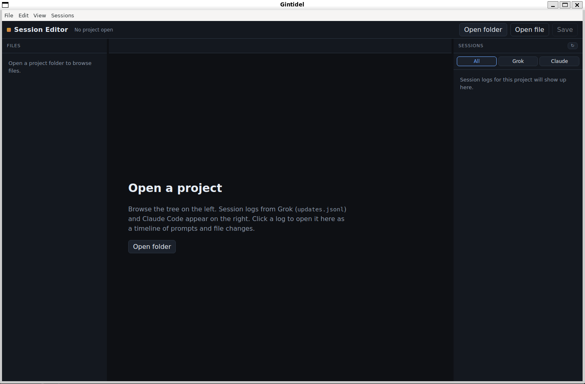
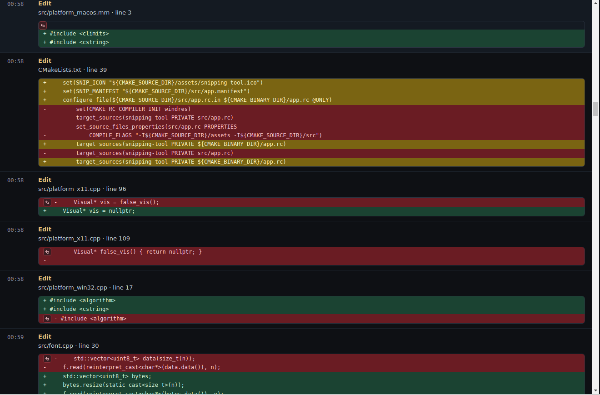

# GINTIDEL
GINTIDEL is an `understanding` tool that makes it easier to observe model code outputs by either plugging into or rewinding their ACP streams. It supports deterministic rollbacks of model changes by using the rewind button. 


It neatly shows the code output produced by the model for a project across several sessions, with code that has been later overwritten shown with a yellow background.



```bash
npm install
npm start
```

Then **Open folder** and choose a repo. The right pane lists session files under:

| Provider | On disk |
|---|---|
| Grok | `~/.grok/sessions/<url-encoded-cwd>/<session-id>/updates.jsonl` |
| Claude Code | `~/.claude/projects/<dashed-cwd>/<session-id>.jsonl` |

Click a row to open that JSONL in the editor. Open a source file to filter the bottom panel to edits that touched that file.

Session JSONL files are read-only so transcripts are not overwritten.